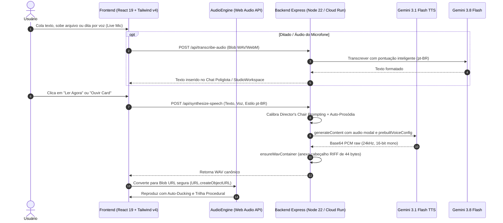

# Especificação de Design, Arquitetura e Navegabilidade (MyTTS Studio)

Este documento estabelece o design system, a arquitetura de interfaces e o plano funcional e ergonômico do **MyTTS Studio**, alinhado ao contrato canônico [`DESIGN.md`](file:///c:/Users/melki/dev/repos/mytts/DESIGN.md) (`v8.0.0`) e às referências globais como **Speechify**, **ElevenLabs** e **Linear**, potencializado pelos modelos neurais **Gemini 3.1 Flash TTS Preview**, **Gemini 3.8 Flash** e **Web Audio API**.

---

## 1. Visão Geral e Intenção Prática

* **Objetivo do Sistema:** Prover uma estação de trabalho de áudio neural de altíssima fidelidade e usabilidade imediata (*zero-friction*), permitindo aos usuários alinhar e traduzir textos em 3 idiomas simultâneos (EN / IT / JA) com síntese por card e Live Mic, colar qualquer texto e ouvir instantaneamente com vozes humanas realistas (respiração, pausas, tom e emoção), sintetizar debates com dois oradores de IA, treinar idiomas com repetição espaçada (*FastChunks*) e exportar master profissional com trilhas sonoras procedurais e auto-ducking dinâmico.
* **Público e Permissões:**
  * Usuários individuais, estudantes, podcasters e profissionais que necessitam de leitura de alta velocidade, estudo poliglota e síntese de áudio de estúdio.
  * Acesso aberto com sessão persistente por dispositivo (`X-User-Id`), sem barreiras de onboarding.

---

## 2. Mapa de Navegabilidade e Arquitetura de UX

```mermaid
graph TD
    A["Sidebar Persistente + Pílula Superior"] --> P["1. Chat Poliglota IA (EN / IT / JA + Live Mic)"]
    A --> B["2. Estúdio de Voz (Solo & Conversa)"]
    A --> D["3. Debate IA (Estúdio Dialético 2 Vozes)"]
    A --> E["4. FastChunks (Treino Lexical de Idiomas)"]
    A --> F["5. Vozes Neurais (Voice Library)"]
    A --> G["Modal: Arquitetura & Governança"]
    
    P --> P1["Alinhamento Paralelo em 3 Colunas (EN · IT · JA)"]
    P --> P2["Barra de Entrada Unificada + Anexo PDF/TXT/MD"]
    P --> P3["Ditado Rápido + Atalho Direto Live Mic API"]
    P --> P4["Controlador de Áudio Flutuante + Trilogia Sequencial"]

    B --> B1["Editor Focado (Colar / Upload PDF / MD / TXT / Ditado)"]
    B --> B2["Alternância Ágil: Solo (1 Voz) vs Conversa (2 Vozes)"]
    B --> B3["Micro-Pontuação de Auto-Prosódia (pt-BR)"]
    B --> B4["Grade Tátil de Vozes Neurais com Preview 3s"]
    
    D --> D1["Ingestão de Artigo ou Ensaio"]
    D --> D2["Roteirização Dramatúrgica Antagônica"]
    D --> D3["Player Estéreo de Debate"]
    
    E --> E1["Seleção de Idioma (EN / IT / JA)"]
    E --> E2["Treino por Shadowing Loop"]
    E --> E3["Síntese Neural de Cada Bloco"]

    B --> H["Dock de Áudio Inferior (Thumb Zone)"]
    D --> H
    H --> H1["Scrubber & Preservação de Pitch"]
    H --> H2["Trilhas Sonoras Procedurais (Lo-Fi, 432Hz, Cinemático, Tech)"]
    H --> H3["Auto-Ducking Dinâmico (-8dB, -14dB, -20dB)"]
    H --> H4["Exportação de Master WAV RIFF Estéreo"]
```

A aplicação adota o padrão canônico de **Navegação em 3 Camadas (Sidebar Lateral Persistente + Barra Superior em Pílula + Breadcrumbs `<ol>` + Command Palette `Ctrl+K`) + Canvas de Trabalho Focado + Thumb-Zone Dock Inferior**:

---

## 3. Diagrama de Fluxo de Dados do Sistema

---

## 4. Especificação de Componentes e Estados de Interface

| Módulo / Tela | Componentes de UI | Comportamento e Regra de Negócio | Estados de Interface |
| :--- | :--- | :--- | :--- |
| **Sidebar Lateral & Topbar** | Brand Logo, 5 Botões de Módulo (`polyglot`, `reader`, `debate`, `chunks`, `voices`), Seletor de 4 Temas Soft UI, Busca `Ctrl+K` | Alterna instantaneamente o canvas ativo via View Transitions API com `#sidebar-active-tracker` em `surface-inset` | Active (`aria-current="page"`), Inactive, Hover, Mobile Drawer |
| **Chat Poliglota IA (Home #1)** | `PolyglotChatStudio.tsx`, `ParallelMessageBlock.tsx`, `LanguageColumnCard.tsx`, `AgentInputDock.tsx`, `FloatingCardAudioController.tsx` | Traduz e alinha frases em EN, IT e JA lado a lado; voz individual por card; clique em qualquer bloco (`<button>`) abre menu de áudio/flashcard; inclui Live Mic direto | Empty (chips de sugestão), Translating, Ready, Playing Single Card, Playing Trilogy (`EN -> IT -> JA`) |
| **Estúdio de Voz (`StudioWorkspace`)** | Central Unificada (`StudioWorkspace.tsx`), Editor de Texto (`StudioTextEditor.tsx`), Seletor de Modo (Solo vs Conversa), Presets Prosódicos e Ditado Integrado | Permite entrada rápida por digitação, drag-and-drop de PDFs/TXTs/MDs ou ditado por voz, com persistência total entre trocas de modo | Empty (placeholder receptivo), Typing, Synthesizing (pulsing wave), Playing, Error |
| **Grade de Vozes (`VoiceCardGrid`)** | Grid com 5 cards táticos (Puck, Kore, Fenrir, Aoede, Enceladus), Botão preview de 3s no card, Indicador de timbre e gênero | Permite audição imediata de cada voz; suporte a acessibilidade (`tabIndex={0}`, `role="radio"`) e revogação atômica de URLs | Idle, Previewing (spinner/onda no card), Selected |
| **Dock de Áudio Inferior** | Botão Play/Pause (56px touch target), Scrubber de progresso, Seletor de velocidade (0.8x a 2.0x), Gaveta expansível (Voz & Trilha Sonora), Exportador Master WAV | Persistente no Estúdio de Voz e Debate; controla grafo multitrack (voz + trilha procedural + auto-ducking dinâmico) | Idle, Buffering, Playing (ondas sonoras reativas), Paused |
| **Estúdio Dialético** | Visualizador de roteiro em cards alternados com avatares dos 2 oradores, Painel de configuração de intensidade de debate | Roteiriza embates filosóficos e práticos a partir de qualquer PDF/texto com diretrizes anti-clichê | Empty, Script Generating, Audio Synthesizing, Ready |
| **FastChunks** | Grid de blocos coloquiais, Seletor de idioma tátil (EN, IT, JA), Modo Drill (Shadowing Loop), Síntese neural Gemini | Treino auditivo de frases com entonação nativa, repetição espaçada e persistência no Firestore | Loading Chunks, Card Idle, Drilling, Neural Synthesizing |

---

## 5. Design System e Identidade Visual (`DESIGN.md` `v8.0.0`)

### 5.1. Paleta de Cores e Tokens Semânticos (60-30-10 & OKLCH)
- **Superfície Primária (`60% --surface-canvas`)**: `#57545d` (Cinza Studio Monolítico no modo padrão), `#F3F3F5` no tema claro editorial (*Ad Lucem*), `#F4F3EC` no tema *Moss* e `#070709` no tema *Obsidian (Terminal IBM)*.
- **Superfícies Secundárias e Elevadas (`30% --surface-flat` / `--surface-raised` / `--surface-inset`)**: `#49464f` / `#635f6a` / `#3e3b44` no Studio Monolítico e `#FFFFFF` puro para cards no *Ad Lucem*, com iluminação direcional de 135° e `1px` de luz especular superior (`--rim-light`).
- **Acento Focal (`10% --accent-point` & Energia Vocal)**: Cerulean Sapphire (`#35acd8` / `#0284C7` — zero azul cobalto) e Âmbar Mineral (`#D97706` / `amber-500`) para ações de síntese e reprodução.
- **Acento Semântico (`Voz & Sucesso`)**: `emerald-500` (`#059669`) para status online, cache `0ms` e Live Mic ativo.
- **Tipografia**: `Outfit` para títulos e botões táteis (`--font-display`); `Inter` / `Plus Jakarta Sans` para leitura contínua (`max-inline-size: 65ch`); `JetBrains Mono` com `font-variant-numeric: tabular-nums` para durações, frequências e indicadores técnicos.

### 5.2. Padrões de Microinteração e Acessibilidade
- **Área Tátil (Touch Targets)**: Altura e largura mínimas de `44px` a `56px` em desktop e `48x48px` em `@media (any-pointer: coarse)` para botões primários.
- **Ordem do DOM = Ordem Visual**: Proibido usar `order-*` no Flexbox/Grid para reordenar controles focáveis; todos os elementos interativos utilizam `<button>` semântico.
- **Nitidez Anti-Borrão e Zero Glassmorphism**: Zero `backdrop-blur` em todo o código; feedback tátil via `translateY(-1px)` / `translateY(0px)` sem `scale()` fracionário em cards de texto.

---

## 6. Endpoints do Sistema (Backend REST)

* `POST /api/synthesize-speech` — Síntese neural de texto corrido com calibração Director's Chair e garantia de container WAV RIFF.
* `POST /api/preview-voice` — Amostra rápida de 3 segundos de qualquer uma das 5 vozes neurais.
* `POST /api/transcribe-audio` — Transcrição neural de áudio do microfone via Gemini 3.8 com pontuação inteligente.
* `POST /api/extract-text` — Extração e parsing multimodal de arquivos PDF, TXT ou Markdown.
* `POST /api/generate-script` — Roteirizador dramatúrgico de debates dialéticos.
* `POST /api/synthesize-turn` — Síntese de turno individual do estúdio de debate.
* `POST /api/synthesize-full` — Geração do episódio completo em master de duas vozes.
* `POST /api/mix-audio` — Mixagem broadcast no servidor via FFmpeg com compressor sidechain nativo.
* `POST /api/synthesize-chunk` — Síntese de bloco coloquial de idioma para o FastChunks.
* `GET /api/chunks` — Recuperação de chunks do Firestore.
* `GET /api/health` — Monitoramento de integridade com probe real (chave Gemini configurada, modo de storage, uptime).
* `POST /api/generate-chunks` — Geração de chunks coloquiais via Gemini com persistência (count clampado a 1–20).
* `POST /api/chunks` — Criação manual de chunk personalizado.
* `DELETE /api/chunks/:id` — Remoção de chunk do usuário.
* `POST /api/translate-parallel-chunks` — Tradução paralela e alinhamento de chunks EN/IT/JA (Chat Poliglota).
* `POST /api/generate-flashcard` — Geração de flashcard para exportação Anki/Notion.

> **Salvaguardas de segurança ativas**: rate limiting (300 req/15min geral, 120 req/15min em endpoints de IA), payloads de 2 MB por padrão (25 MB em `/api/transcribe-audio`, 50 MB em `/api/mix-audio`), truncamento de textos para síntese (20k caracteres), sanitização do header `X-User-Id`, headers Helmet e 404 JSON estruturado para rotas de API desconhecidas.
