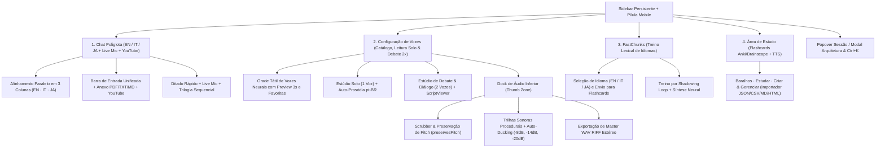
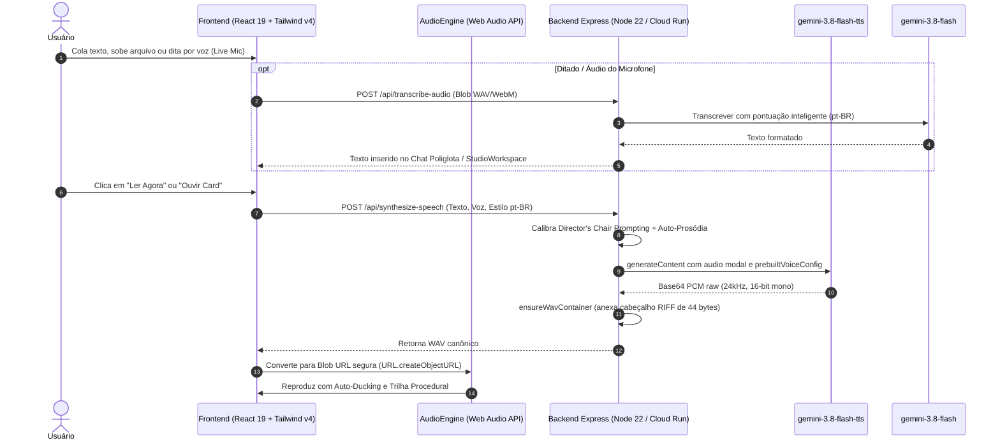

# Especificação de Design, Arquitetura e Navegabilidade (MyTTS Studio)

Este documento estabelece o design system, a arquitetura de interfaces e o plano funcional e ergonômico do **MyTTS Studio**, alinhado ao contrato canônico [`DESIGN.md`](file:///c:/Users/melki/dev/repos/mytts/DESIGN.md) e às referências globais como **Speechify**, **ElevenLabs** e **Linear**, potencializado pelos modelos neurais **`gemini-3.8-flash-tts`**, **`gemini-3.8-flash`** e **Web Audio API**.

---

## 1. Visão Geral e Intenção Prática

* **Objetivo do Sistema:** Prover uma estação de trabalho de áudio neural de altíssima fidelidade e usabilidade imediata (*zero-friction*), permitindo aos usuários alinhar e traduzir textos em 3 idiomas simultâneos (EN / IT / JA) com síntese por card e Live Mic, colar qualquer texto e ouvir instantaneamente com vozes humanas realistas (respiração, pausas, tom e emoção), sintetizar debates com dois oradores de IA, treinar idiomas com repetição espaçada (*FastChunks*) e exportar master profissional com trilhas sonoras procedurais e auto-ducking dinâmico.
* **Público e Permissões:**
  * Usuários individuais, estudantes, podcasters e profissionais que necessitam de leitura de alta velocidade, estudo poliglota e síntese de áudio de estúdio.
  * Acesso aberto com sessão persistente por dispositivo (`X-User-Id`), sem barreiras de onboarding.

---

## 2. Mapa de Navegabilidade e Arquitetura de UX

A aplicação adota o padrão canônico de **Navegação em 3 Camadas (Sidebar Lateral Persistente + Barra Superior em Pílula + Breadcrumbs `<ol>` + Command Palette `Ctrl+K`) + Canvas de Trabalho Focado + Thumb-Zone Dock Inferior**:

---

## 3. Diagrama de Fluxo de Dados do Sistema

---

## 4. Especificação de Componentes e Estados de Interface

| Módulo / Tela | Componentes de UI | Comportamento e Regra de Negócio | Estados de Interface |
| :--- | :--- | :--- | :--- |
| **Sidebar Lateral & Topbar** | Brand Logo, 4 Botões de Módulo (`polyglot`, `voices`, `chunks`, `study`), Popover `UserSessionPopover` (2 temas foscos OKLCH), Busca `Ctrl+K`, Histórico `Ctrl+H` | Alterna o canvas ativo (preservando `PolyglotChatStudio` montado via `hidden`) com `#sidebar-active-tracker` e rail recolhível (`Ctrl+B`) | Active (`aria-current="page"`), Inactive, Hover, Collapsed Rail (`68px`), Mobile Drawer |
| **Chat Poliglota IA (Home #1)** | `PolyglotChatStudio.tsx`, `ParallelMessageBlock.tsx`, `LanguageColumnCard.tsx`, `AgentInputDock.tsx`, `FloatingCardAudioController.tsx` | Traduz e alinha frases em EN, IT e JA lado a lado; voz individual por card; clique em qualquer bloco (`<button>`) abre menu de áudio/flashcard; inclui Live Mic e YouTube | Empty (chips de sugestão), Translating, Ready, Playing Single Card, Playing Trilogy (`EN -> IT -> JA`) |
| **Configuração de Vozes (`VoiceConfigWorkspace`)** | Sub-abas (`Catálogo & Favoritas`, `Leitura Solo · 1 Voz`, `Debate & Diálogo · 2 Vozes`), `VoiceCardGrid`, `StudioWorkspace`, `DebateConfigPanel`, `ScriptViewer` | Centraliza escolha de vozes com preview 3s, leitura solo e debate 2 vozes com geração por PDF/texto/YouTube | Idle, Previewing, Script Generating, Synthesizing, Playing, Error |
| **FastChunks** | `FastChunkAudioApp.tsx`, Grid de blocos coloquiais, Seletor EN/IT/JA, Modo Drill (Shadowing Loop), Botão `+ Flashcard` | Treino auditivo de frases com entonação nativa, exportação direta para baralhos de estudo e persistência no Firestore/local | Loading Chunks, Card Idle, Drilling, Neural Synthesizing |
| **Área de Estudo (`StudyArenaView`)** | `StudyDeckOverview.tsx`, `FlashcardCreatorPanel.tsx`, `FlashcardImporterModal.tsx` | Baralhos estilo Anki/Brainscape (`Baralhos`, `Estudar`, `Criar & Gerenciar`), importação JSON/CSV/MD/HTML e áudio TTS na voz ativa | Deck List, Studying Front/Back, Creating/Editing, Error |
| **Dock de Áudio Inferior** | `BottomAudioDock.tsx` (Botão Play/Pause, Scrubber, velocidade com `preservesPitch`, Trilha Procedural, Exportador WAV) | Controla reprodução multitrack e exportação Master WAV RIFF | Idle, Buffering, Playing, Paused |

---

## 5. Design System e Identidade Visual (`DESIGN.md`)

### 5.1. Paleta de Cores e Tokens Semânticos (OKLCH · `Tactile Matte` & `Steadfast Stainless`)
- **Preset Escuro — `obsidian` (`Tactile Matte`)**: `--surface-canvas: oklch(0.155 0.012 260)`, `--surface-flat: oklch(0.195 0.018 262)`, `--surface-raised: oklch(0.23 0.02 262)`, `--surface-inset: oklch(0.125 0.01 260)` com iluminação zenital radial (`120%`) e borda hairline `oklch(1 0 0 / 0.055)`.
- **Preset Claro — `slate` (`Steadfast Stainless`)**: `--surface-canvas: oklch(0.93 0.01 250)`, `--surface-flat: oklch(0.955 0.006 250)`, `--surface-raised: oklch(0.975 0.005 250)`, `--surface-inset: oklch(0.89 0.012 250)` com borda hairline `oklch(0.2 0.02 255 / 0.075)`.
- **Acento Focal (`10% --accent-point` & Energia Vocal)**: Azul Ciano Técnico (`#35acd8` / `#0284C7` — zero azul cobalto) e Âmbar Mineral (`amber-500`) para ações de síntese e reprodução.
- **Acento Semântico (`Voz & Sucesso`)**: `emerald-500` (`#059669`) para status online, cache `0ms` e Live Mic ativo.
- **Tipografia**: `Outfit` para títulos e botões táteis (`--font-display`); `Inter` / `Plus Jakarta Sans` para leitura contínua (`max-inline-size: 65ch`); `JetBrains Mono` com `font-variant-numeric: tabular-nums` para durações, frequências e indicadores técnicos.

### 5.2. Padrões de Microinteração e Acessibilidade
- **Área Tátil (Touch Targets)**: Altura e largura mínimas de `44px` a `56px` em desktop e `48x48px` em `@media (any-pointer: coarse)` para botões primários.
- **Ordem do DOM = Ordem Visual**: Proibido usar `order-*` no Flexbox/Grid para reordenar controles focáveis; todos os elementos interativos utilizam `<button>` semântico.
- **Nitidez Anti-Borrão e Zero Glassmorphism**: Zero `backdrop-blur` em todo o código; feedback tátil via `translateY(-1px)` / `translateY(0px)` sem `scale()` fracionário em cards de texto.

---

## 6. Endpoints do Sistema (Backend REST)

* `POST /api/synthesize-speech` — Síntese neural de texto corrido com calibração Director's Chair e garantia de container WAV RIFF.
* `POST /api/preview-voice` — Amostra rápida de 3 segundos de qualquer uma das 5 vozes neurais.
* `POST /api/transcribe-audio` — Transcrição neural de áudio do microfone via Gemini 3.8 com pontuação inteligente.
* `POST /api/extract-text` — Extração e parsing multimodal de arquivos PDF, TXT ou Markdown.
* `POST /api/generate-script` — Roteirizador dramatúrgico de debates dialéticos.
* `POST /api/synthesize-turn` — Síntese de turno individual do estúdio de debate.
* `POST /api/synthesize-full` — Geração do episódio completo em master de duas vozes.
* `POST /api/mix-audio` — Mixagem broadcast no servidor via FFmpeg com compressor sidechain nativo.
* `POST /api/synthesize-chunk` — Síntese de bloco coloquial de idioma para o FastChunks.
* `GET /api/chunks` — Recuperação de chunks do Firestore.
* `GET /api/health` — Monitoramento de integridade com probe real (chave Gemini configurada, modo de storage, uptime).
* `POST /api/generate-chunks` — Geração de chunks coloquiais via Gemini com persistência (count clampado a 1–20).
* `POST /api/chunks` — Criação manual de chunk personalizado.
* `DELETE /api/chunks/:id` — Remoção de chunk do usuário.
* `POST /api/translate-parallel-chunks` — Tradução paralela e alinhamento de chunks EN/IT/JA (Chat Poliglota).
* `POST /api/live-agent-turn` — Turno de áudio Live Mic com resposta alinhada + chamadas de ferramentas (`create_study_flashcard`, `switch_studio_voice`).
* `POST /api/agent-explore` e `GET /api/youtube/metadata` — Exploração de temas/vídeos do YouTube com grounding e extração de metadados.
* `GET / POST / DELETE /api/flashcards` — Persistência de baralhos e flashcards por usuário (Firestore + fallback `.data/flashcards.json`).
* `POST /api/generate-flashcard` — Geração de flashcard para exportação Anki/Notion.

> **Salvaguardas de segurança ativas**: rate limiting (300 req/15min geral, 120 req/15min em endpoints de IA), payloads de 2 MB por padrão (25 MB em `/api/transcribe-audio`, 50 MB em `/api/mix-audio`), truncamento de textos para síntese (20k caracteres), sanitização do header `X-User-Id`, headers Helmet e 404 JSON estruturado para rotas de API desconhecidas.
